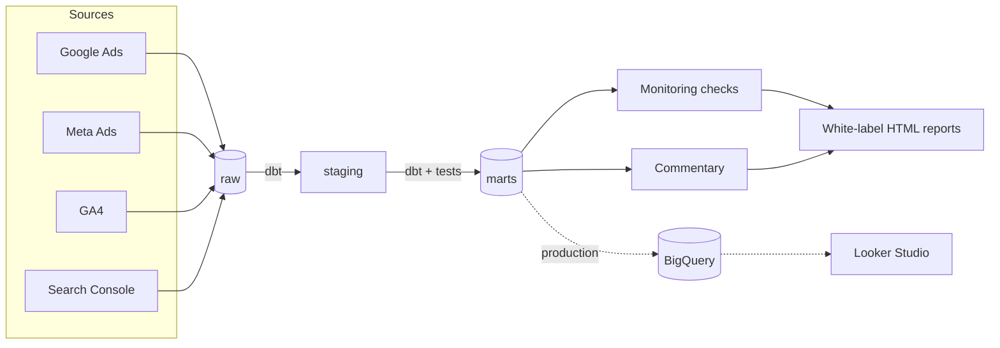

# Agency Reporting Pipeline

**Client reporting infrastructure for PPC, SEO and paid-social agencies: Google Ads, Meta Ads, GA4 and Search Console in one warehouse, one set of tested numbers, and a white-label report per client.**

If your team spends 20 to 30 hours per client per month pulling exports, reconciling Google Ads against GA4, formatting decks and writing commentary, most of that time is mechanical. This repository is a working reference implementation of the pipeline that removes it: sources land in a warehouse, dbt models turn them into trusted marts, monitoring catches broken tracking before your client does, and each client gets a branded report with plain-English commentary. It runs end to end on synthetic data with one command; in production the same dbt project runs on BigQuery with a Looker Studio front end.

**Live demo:** [ercantncy.github.io/agency-pipeline](https://ercantncy.github.io/agency-pipeline/): the agency web app (portfolio overview, per-client dashboards, alert center, white-label client report) on three synthetic clients, rebuilt by CI on every push.

## Web app

`web/` is a static React app (Vite, TypeScript, Tailwind, Recharts). The pipeline exports JSON to `web/public/data` (`agency-pipeline export-web`, also the last step of `run`); the app reads it, so there is no backend and it deploys to any static host.

```bash
cd web && npm ci && npm run dev        # http://localhost:5173
```

Screens: portfolio overview, client detail (overview, paid media, campaigns, website, SEO, data quality), alert center, and a print-ready white-label report at `#/report/<client>/<month>`. Contract: [docs/WEB_SPEC.md](docs/WEB_SPEC.md).

## Tracking & Reporting Audit

The entry-level engagement: an agency sends four CSV exports (Google Ads, GA4, Meta, optional Search Console) and gets a one-page scorecard with six checks, a 0–100 score and the top three fixes.

```bash
uv run agency-pipeline audit --google-ads ads.csv --ga4 ga4.csv --meta meta.csv --gsc Dates.csv --client-name "Acme Dental"
```

Samples: [BluePeak Dental (38/100)](docs/samples/audit-bluepeak-dental.html), [Harbor Coffee (68/100)](docs/samples/audit-harbor-coffee.html). Export guide for agencies: [docs/audit-csv-guide.md](docs/audit-csv-guide.md).

## Architecture



Locally the warehouse is DuckDB (`data/warehouse.duckdb`). The production path swaps the dbt target to BigQuery and points Looker Studio at the marts. See [docs/looker-studio-setup.md](docs/looker-studio-setup.md).

## Quickstart

```bash
uv sync
uv run agency-pipeline run          # extract-load -> transform -> check -> report (October 2026)
open output/reports/bluepeak-dental/2026-10.html
```

Individual stages: `extract-load`, `transform`, `check [--json]`, `report --client <id|all> --month YYYY-MM [--no-llm]`, and `export-web` (JSON for the web app). `run` always builds the reports, then exits with code 1 if any critical alert is open.

## Three synthetic clients, three scenarios

| Client | Scenario | What it demonstrates |
|---|---|---|
| `northwind-outdoor` | `healthy` | A clean month: Google Ads clicks and GA4 sessions reconcile, all checks pass, the report shows the green state. |
| `bluepeak-dental` | `broken_autotagging` | GA4 records only 15 to 20% of paid-search clicks (the classic "1,691 clicks vs 298 sessions" problem). Paid traffic leaks into organic and direct; reconciliation raises a critical alert and the report explains it in plain English. See [docs/explainer-clicks-vs-sessions.md](docs/explainer-clicks-vs-sessions.md). |
| `harbor-coffee` | `tracking_outage` | GA4 records almost nothing for three consecutive days. The volume-drop check catches the outage, and the report flags those days as missing rather than as a real traffic collapse. |

All three share one agency brand ("Brightline Digital") to show white-labelling; the schema allows a brand per client.

## Repo layout

```
config/clients.yml           client registry (brand, currency, account ids, scenario)
src/agency_pipeline/
  sources/                   source interface + deterministic synthetic sources
  load.py                    extract -> DuckDB raw schema (idempotent)
  monitoring.py              freshness, reconciliation and volume-drop checks
  commentary.py              monthly commentary (Claude or template)
  reporting/                 HTML report builder, Jinja template, CSS
  cli.py                     `agency-pipeline` entry point
dbt/                         staging + marts models and tests (DuckDB dev, BigQuery prod)
tests/                       pytest suite
docs/                        spec, offer, explainers, Looker Studio guide
.github/workflows/ci.yml     lint, tests, full run, reports as artifact
```

## Data model

| Table (schema `marts`) | Grain | Purpose |
|---|---|---|
| `dim_client` | client | Name, agency brand, currency, account ids |
| `fct_paid_daily` | client, date, channel, campaign | Spend, impressions, clicks, platform conversions |
| `fct_web_daily` | client, date, channel group | Sessions, engaged sessions, users, key events, revenue |
| `fct_paid_vs_ga4_reconciliation` | client, date, channel | Ad clicks vs GA4 sessions, ratio and ok/warn/critical status |
| `fct_seo_daily` | client, date | Search Console clicks, impressions, CTR, average position |
| `fct_seo_query_monthly` | client, month, query | Query-level SEO performance |
| `rpt_client_monthly` | client, month, channel | Monthly KPIs with month-over-month change (CPA, ROAS, spend, conversions) |

dbt runs 60+ tests on grains, accepted values and non-negative spend on every build.

## Monitoring

`agency-pipeline check` runs three checks over the marts and exits 1 on any critical:

- **Freshness**: a source whose latest day is older than expected.
- **Reconciliation**: days where GA4 sessions fall far below ad-platform clicks (Google Ads: warn under 50%, critical under 30%; Meta: 40% and 20%).
- **Volume drop**: GA4 sessions below 30% of the trailing 14-day median, which usually means a tracking outage.

Open alerts appear in the report's Data quality section with a plain-English explanation.

## Commentary

Each report opens with a short client-friendly paragraph. With `ANTHROPIC_API_KEY` set, Claude writes it from a compact JSON of the month's KPIs, changes and alerts (no numbers beyond that JSON); the CLI logs that LLM text is a draft to review before sending. Without a key, or with `--no-llm`, a deterministic template writes it, so the pipeline never depends on an API.

## Reports

One self-contained HTML file per client and month (`output/reports/<client_id>/<YYYY-MM>.html`): charts are inlined, there are no network requests, it prints cleanly with a page break per section, and it reads on a phone. Seven sections: executive summary, paid overview, Google Ads campaigns, Meta Ads campaigns, website traffic, organic search, data quality.

## Production notes

- Switch dbt to the `prod` target (BigQuery) and replace the synthetic sources with real connectors or API extractors; the raw table shapes mirror the Google Ads, Meta, GA4 and Search Console APIs.
- Connect Looker Studio to the marts for live dashboards: [docs/looker-studio-setup.md](docs/looker-studio-setup.md).
- Schedule `run` (cron, GitHub Actions, Cloud Run job) and route alerts to email or Slack.

## More documentation

- [docs/SPEC.md](docs/SPEC.md): build specification
- [docs/offer-one-pager.md](docs/offer-one-pager.md): the service offer and hours math
- [docs/explainer-clicks-vs-sessions.md](docs/explainer-clicks-vs-sessions.md): why Google Ads and GA4 disagree
- [docs/looker-studio-setup.md](docs/looker-studio-setup.md): BigQuery and Looker Studio path

## License

MIT. See [LICENSE](LICENSE).
